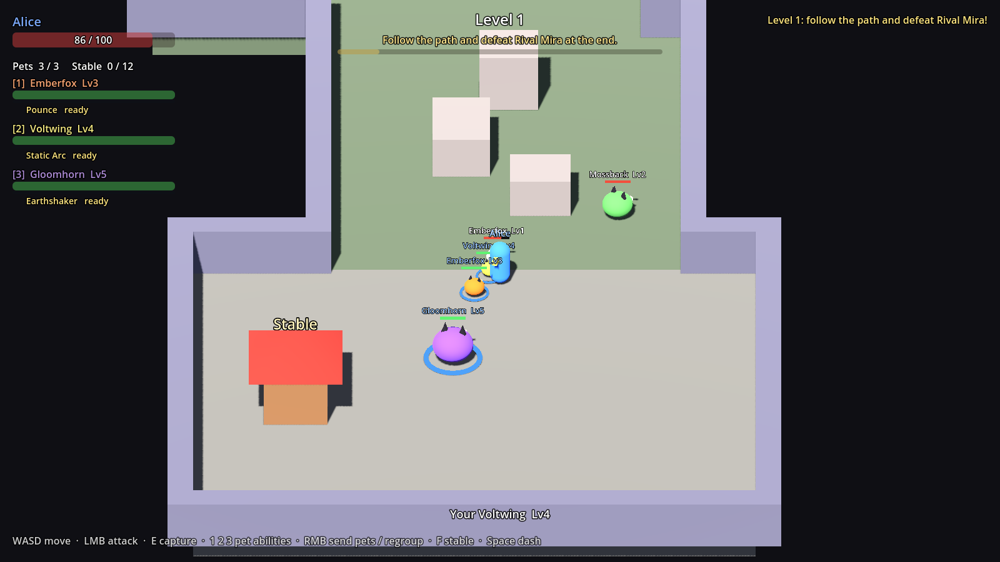

# Pack Leader

Co-op (2–4 players) isometric action RPG where **pets are the focus**: every
creature in the world can be captured, then follows you, fights for you and
levels up. Each level is a randomly generated path from a start camp to a
rival tamer waiting at the end.



## Run
Open `project.godot` in Godot 4.4+ and press F5. Click **Play solo**, or have
one player click **Host** while the others enter the host's address and click
**Join**. Networking uses WebSockets on **TCP port 24565**; for play over the
internet the host must forward that port (or use a tunnel, see below).

Quick local test with two instances, from the command line:
```
godot --path . -- --host --name=Alice
godot --path . -- --join=127.0.0.1 --name=Bob
godot --path . -- --solo
```
Or in the editor: *Debug → Customize Run Instances*, enable 2 instances, and
give them the arguments `--host` and `--join=127.0.0.1`.

## Saving
Progress is saved automatically: when a level starts, whenever your party or
stable changes, every 20 seconds, and when you close the game. There are
**3 save slots**; the title screen shows which one you're about to play, with
**New Game** (first free slot) and **Load Game** (load or delete a slot).

A save holds your tamer's name, party, hay beds, coins, potions and the
furthest level reached. Each player's save lives on **their own computer**
(`user://saves`, e.g. `%APPDATA%/Godot/app_userdata/Pack Leader/saves` on
Windows; in the browser it's stored by the browser), so you can bring your
tamer and pets into a friend's game. When you join, your save is sent to the
host, which checks it (real species, sensible levels, at most 3 party pets
and 20 beds) before restoring it. The host's save decides which level the
game starts on.

## Building a Windows .exe
Export presets for Windows and Linux are included (`export_presets.cfg`).
1. In Godot: **Editor → Manage Export Templates → Download and Install** (once).
2. **Project → Export**, choose **Windows Desktop**, click **Export Project**.

The game data is embedded, so the result is a single `PackLeader.exe` you can
share. From the command line:
```
godot --headless --path . --export-release "Windows Desktop" export/windows/PackLeader.exe
```

## Playing in a browser
Export the **Web** preset (or use a release zip): it produces `index.html` plus a
few files. It needs no special server headers (it is built without threads), so
any static host works. The easiest is [itch.io](https://itch.io): create an
HTML game, upload the zipped `export/web` folder, and tick "This file will be
played in the browser".

- **Solo** works anywhere: click **Play solo**, or open `index.html?solo`.
- **Multiplayer:** browsers can **join** but not **host**. Someone hosts from the
  desktop version, and browser players join it. Desktop and browser players can
  play together.
- A page served over **https** (like itch.io) may only connect to a secure
  `wss://` address. The host can get one without a certificate by running a
  tunnel, for example [Cloudflare's free quick tunnel](https://developers.cloudflare.com/cloudflare-one/connections/connect-networks/do-more-with-tunnels/trycloudflare/):
  `cloudflared tunnel --url http://localhost:24565`. It prints an
  `https://….trycloudflare.com` address; players type it into **Join** as
  `wss://….trycloudflare.com`.
- Join links: `index.html?join=wss://example.trycloudflare.com&name=Bob` connects
  straight away.

## How to play
| Input | Action |
|---|---|
| WASD | Move |
| LMB | Swing your bat toward the mouse: weakens creatures (never below 1 HP) and smashes vases |
| E | Throw a capture at the creature under the mouse |
| RMB on a wild creature or the rival | Send your pets to attack it |
| RMB on the ground | Pets drop their target and regroup |
| T (or the stance button under your pets) | Toggle pets between **Aggressive** and **Passive** |
| 1 / 2 / 3 | Use the ability of the pet in that party slot, aimed at the mouse |
| Q | Drink a health potion (heals 50%) |
| F (at the stable / lemonade stand) | Open/close the stable or the shop |
| K | Open/close the pet skills screen |
| I | Open/close your inventory (gear and bag) |
| Mouse wheel | Zoom the camera in and out (remembered between games) |
| M | Switch the mini map between the corner and a large view of the whole level |
| Esc | Close whatever menu is open (stable, shop, a confirmation, the Load Game list); with nothing open, the in-game menu: resume, save, quit to the main menu (solo pauses) |
| Space | Dash (brief invulnerability) |

- **Levels:** each level is one long, wide, randomly generated path that
  always runs from left to right across the screen, winding up and down, with rocks and packs of
  wild creatures that get tougher the further you go. It starts at a camp with
  the stable and ends in a boss arena. Defeat the boss and a portal opens at
  the far end; step in and everyone moves on to the next, harder level, and
  every pet gets bonus XP.
- **Acts and biomes:** the four biomes make up **Act 1**, one area each, and
  each area's creatures are five levels higher than the last: **Greenmeadow
  1-5, Frostfang Peaks 6-10, Sunscorch Dunes 11-15, Mirewood Bog 16-20**
  (weakest by the camp, strongest near the boss; the rival's pet is at the
  top level). After the Bog Witch comes **Act 2: Hollowmere Graveyard**
  (21-25), haunted by **skeletons and zombies**. They are monsters, not
  creatures: they can't be captured, and your bat finishes them off (no 1 HP
  limit). Bring your pets from Act 1. After Howard the Zombie Fish the acts loop: Act 3
  is Greenmeadow again at 26-30, and so on. Bosses get tougher to match. The HUD shows the act, area and
  creature levels.

  Every boss has its own model: the rival is a tamer in a wide-brimmed hat and
  cape who swings a bat, the Glacier Titan a hulking ice golem with crystal
  shoulders and huge fists, the Sand Wyrm an armoured worm rearing out of a
  sand mound with a toothy maw and snapping mandibles, and the Bog Witch a
  hunched, floating witch with a crooked hat and a glowing staff.

  | Area | Biome | Creatures | Boss |
  |---|---|---|---|
  | Act 1 area 1 (Lv 1-5) | Greenmeadow | Cats: Mossback, Emberfox, Voltwing, Gloomhorn, Bloomling (the first two creatures by the camp are always Bloomlings) | **Rival Tamer** with one pet. The pet fights and uses its ability; when the rival is beaten the pet goes wild, weakened, so you can capture it |
  | Act 1 area 2 (Lv 6-10) | Frostfang Peaks | Birds: Frostfinch, Quillpuff, Aurora Swift, Snowl | **Glacier Titan**: drops Avalanches (a red warning circle, then a slam that damages and slows) and summons capturable Frostfinches at 66% and 33% health |
  | Act 1 area 3 (Lv 11-15) | Sunscorch Dunes (desert) | Dogs: Fangjackal, Dunehound, Cactipup, Sunfennec | **Sand Wyrm**: burrows underground (it can't be hit there), tunnels under a player or pet behind a warning circle and erupts; at half health it whips up sandstorms |
  | Act 1 area 4 (Lv 16-20) | Mirewood Bog (swamp) | Lizards: Bogleon, Mirelurk, Wisp Gecko, Sporeguana | **Bog Witch**: a ranged caster whose bolts poison; she blinks away when you get close, drops toxic puddles and summons Bogleons at 60% and 30% health |
  | Act 2 area 1 (Lv 21-25) | Hollowmere Graveyard | Monsters: Skeletons (quick, with rusty swords) and Zombies (slow, tough, hit hard); can't be captured | **Howard the Zombie Fish**: a huge rotting fish on a pair of zombie legs, one eye bulging and one crossed out, ribs showing, a fishhook in his lip. He spits a Rotten Splash under a player or pet (a red warning circle, then damage and a slow), and calls up skeletons and a zombie at 66% and 33% health |
- **Tamer health:** after 5 seconds without taking damage you regenerate 3% of
  your max health per second. You carry up to **2 potions** (Q heals 50%),
  and start every level with a full pair. Bloomlings and Aurora Swifts can heal
  you too.
- **Lemonade stand:** halfway along every level there is a lemonade stand in
  a safe clearing. Press F there to buy from the vendor:
  - **Potion** (10 coins), up to the 2 you can carry.
  - **Lucky Lemonade** (15 coins): capture chance x1.5 for 90 seconds (still
    capped at 95%). Buying another while it's active resets the timer; it
    doesn't stack. The HUD and the hover capture chance include the boost.
- **Vases and coins:** clay vases along the path shatter in one hit and spill
  coins (gold vases are rarer and hold far more). Walk over coins to
  pick them up; coins belong to whoever collects them and carry over between
  levels.
- **Mini map:** bottom right, showing the path around you the way the camera
  sees it: rocks, vases, the stable (brown), the lemonade stand (yellow), the
  portal (purple, filled when open), the boss (big red), wild creatures (red),
  your pets (green), other players and their pets (in their colours) and you
  (an arrow). Press M for the whole level, large; M or Esc to shrink it.
- **Your tamer** is a little person with a bat, drawn in your colour (hair
  colour varies by player). They walk with swinging arms and legs; attacking
  swings the bat, and every hit pops a ring of spinning stars.
- **Village:** halfway along every level, a side path leads up the screen
  (through a doorway in the far wall) to a small village square: a few houses,
  a second **stable** and the **Bat Shop**. No wild creatures are placed
  there. At the Bat Shop (F) you can upgrade your Wooden Bat (12 damage) to a
  **Spiked Bat** (22 damage) for 60 coins, and once you reach Act 2, to the
  **Chain Bat** (36 damage, wrapped in a heavy chain) for 150 coins. Every bat
  still stops creatures at 1 HP (monsters it kills). Your bat is saved.
  The lemonade stand now sits on the stretch of path just before the village.
- **Breeder (village):** press F at the pink stall with the hay pen. Pick two
  different pets **of the same kind** (from your party or stable, any level)
  and pay 25 coins: they have a **hybrid** baby, a new species that only
  comes from breeding. No cross-breeding: cats only breed with cats, birds
  with birds, dogs with dogs and lizards with lizards. Each of the 28 pairings
  (10 cat, 6 bird, 6 dog, 6 lizard) makes its own hybrid, stronger than
  either parent (20% more health and attack than the better one), bigger,
  with a horn, mane (a frill or ruff), crown or wings (leathery on lizards)
  and a powered-up ability. The parents stay with you; the baby
  (born at 75% of its parents' average level, rounded down: two level 10
  parents have a level 7 baby) joins your party, or the first free hay bed. Hybrids can't be bred
  again.

  | Parents | Hybrid | Ability |
  |---|---|---|
  | Mossback + Emberfox | Magmashell | Magma Orb: (Fire) Lobs a ball of magma at the spot: it bursts for 2x damage and leaves a pool of fire burning for 4s. |
  | Mossback + Voltwing | Thundershell | Thunderstorm: (Lightning) A storm over the spot for 3s: 6 bolts strike enemies within 4 units, each for 1.4x damage and a short stun. |
  | Mossback + Gloomhorn | Stonehorn | Hailstorm: (Water) Six hailstones crash down around the spot, each 1.3x damage where it lands, slowing enemies for 2s. |
  | Mossback + Bloomling | Mossbloom | Gale Blades: (Air) Slicing winds fan out towards where you aim: 2.2x damage in a wide 6.5-unit cone, hurling enemies back. |
  | Emberfox + Voltwing | Blitzfox | Lightning Bolt: (Lightning) Strikes the spot with a bolt from the sky: 4x damage and a short stun around it. |
  | Emberfox + Gloomhorn | Cinderhorn | Meteor Shower: (Fire) Rains three blazing meteors around the spot, each 2.2x damage and a 1.5s stun. |
  | Emberfox + Bloomling | Sunpetal | Flame Wave: (Fire) A wave of fire rolls out towards where you aim: 2x damage in a 7-unit cone, sets enemies burning, and scorches the ground for 4s. |
  | Voltwing + Gloomhorn | Stormhorn | Thunder Chain: (Lightning) A huge bolt strikes the spot for 2.2x, then lightning jumps on to 5 more enemies. |
  | Voltwing + Bloomling | Sparkblossom | Ball Lightning: (Lightning) A crackling ball flies to the spot and bursts for 1.8x damage, then arcs on to 4 more enemies. |
  | Gloomhorn + Bloomling | Duskbloom | Void Cyclone: (Air) A dark whirlwind at the spot for 5s: pulls enemies in, slows them to 40% and tears at them. |
  | Frostfinch + Quillpuff | Glacipuff | Hail Volley: Fires 5 frozen arrows in a cone towards where you aim, each 1.3x damage and slowing to 40% for 3s. |
  | Frostfinch + Aurora Swift | Shimmerwing | Eagle Eye: A rallying cry: every pet within 6 units of the spot gets +50% crit chance for 8s (crits do double damage). |
  | Frostfinch + Snowl | Rimeowl | Snipe: A long-range shot at the enemy nearest where you aim (up to 16 units): 4.5x damage and a 1s stun. |
  | Quillpuff + Aurora Swift | Prismpuff | Prism Shot: A dazzling arrow at the spot: 2x damage there, and every enemy near it is blinded (half their attacks miss) for 4s. |
  | Quillpuff + Snowl | Quillowl | Rain of Arrows: Rains 10 arrows down over the area where you aim, each hitting what it lands near for 1.2x damage. |
  | Aurora Swift + Snowl | Dawnowl | Sunburst Arrow: A blazing arrow at the spot that explodes: 2.2x damage to everything within 3 units, setting them burning. |
  | Fangjackal + Dunehound | Duneripper | Consecration: (Heal) Hallows the ground where you aim for 6s: enemies inside burn, allies inside heal 6% of their max health every second. |
  | Fangjackal + Cactipup | Thornjackal | Judgement: (Taunt) Leaps to the spot and smites every enemy there for 2x, taunting them, then heals itself 20% and the most injured ally by the damage dealt. |
  | Fangjackal + Sunfennec | Solarjackal | Holy Light: (Heal) A flash of holy light at the spot: damages and blinds enemies there for 5s and heals every ally there for 25%. |
  | Dunehound + Cactipup | Cactihound | Shield Wall: (Shield, taunt) Throws up a wall of shields around the spot: allies there absorb 35% of their max health for 6s and enemies there are taunted onto it. |
  | Dunehound + Sunfennec | Sunhound | Sunlit Sanctuary: (Heal) A wide circle of sunlight at the spot for 7s: allies inside heal 10% of their max health every second, enemies inside are scorched. |
  | Cactipup + Sunfennec | Bloomfennec | Blessing of the Dunes: (Heal) Heals every pet and player around the spot for 40% of their max health, and the most injured of them 20% more. |
  | Bogleon + Mirelurk | Swampdrake | Swamp Fang: Yanks the enemy nearest where you aim next to it, bites for 2x and poisons it hard (120% of its damage a second for 7s). |
  | Bogleon + Wisp Gecko | Glowleon | Soul Rot: Spits rot where you aim: 2.2x damage and heavy poison for 7s, and it and you heal for 50% of the hit. |
  | Bogleon + Sporeguana | Toxileon | Toxic Haze: A toxic burst where you aim: every enemy within 6 units is poisoned for 7s and deals 50% less damage. |
  | Mirelurk + Wisp Gecko | Wraithlurk | Spirit Trap: Hides a trap where you aim (up to 4). The first enemy to step on it springs it: enemies nearby are damaged and rooted for 3.5s. They are poisoned too, for 6s. |
  | Mirelurk + Sporeguana | Mossdrake | Toxic Bog: A pool of poisonous mud at the target for 7s: everything inside is poisoned (100% of its damage a second). |
  | Wisp Gecko + Sporeguana | Sporewisp | Plague Spores: Bursts plague spores at the spot: every enemy within 6 units is poisoned for 6s, and every pet and player nearby heals 20%. |
- **Pets are animated** too, at the pace they actually move: cats and dogs
  trot (diagonal legs together) and sway or wag their tails, birds hop and flap,
  lizards paddle in a sprawl and swing their bodies and tails, winged hybrids
  flap, and everyone breathes a little standing still.
- **Loot and inventory (I):** gear drops as glowing sacks (a beam of light in
  the item's rarity colour, its name above it): from vases (12%, gold vases
  40%), defeated wild creatures (8%) and every boss. Walk over a sack to put
  it in your **bag** (24 places): a ring and a column of light in its rarity
  colour flash around your tamer, the item's icon and name float up over your
  head (everyone sees it), and the Inventory button shows how many new items
  you have until you open it. The inventory shows your **eight gear slots**
  (weapon, chest, pants, hat, boots, two rings, a necklace) and the bag. It's all drag and drop: drag an item onto its gear slot to
  wear it (swapping with what you had on; the slots it fits light up while
  you drag), drag worn gear into the bag to take it off, drag within the bag
  to tidy it, or drop it on the bin to throw it away (it asks first). To clear
  out lots at once, press **Select** (or right-click an item), click the junk to
  mark it (or **All**, then unmark keepers), and **Throw away** with one confirm. Click an
  item to see what it does; double-click is a shortcut. The weapon slot shows your bat (upgrade it at the Bat
  Shop). Every kind of gear comes in five levels, one per area (areas past
  level 5 drop level 5 gear), each Common, Fine or Superior:

  | Gear | Helps | Levels 1-5 (Common) | Fine / Superior adds |
  |---|---|---|---|
  | Jacket (chest) | Tamer: less damage taken | Tattered, Leather, Padded, Studded, Ranger's: 4-16% | +2% / +4% |
  | Pants | Tamer: less damage taken | Patched Trousers, Leather, Padded, Studded, Ranger's: 2-10% | +1% / +2% |
  | Hat | Tamer: more max health | Straw Hat, Leather Cap, Wool Hat, Iron Helm, Ranger's Hat: +10-30 | +5 / +10 |
  | Boots | Tamer: moves faster | Worn Sandals, Leather Boots, Fur Boots, Desert Striders, Ranger's Boots: 3-11% | +2% / +4% |
  | Ring (x2) | Pets: more damage | Copper, Fang, Silver, Claw, Alpha Ring: 3-12% | +2% / +4% |
  | Necklace | Pets: more max health | Bead Necklace, Tooth Necklace, Shell Pendant, Jade Amulet, Heart of the Pack: 5-18% | +3% / +6% |
  | Spiked collar (pet) | That pet: more damage | Thorn, Spiked, Fang, Razor, Alpha Collar: 5-18% | +2% / +4% |
  | Padded collar (pet) | That pet: more max health | Cloth, Padded, Fleece, Quilted, Guardian Collar: 6-22% | +3% / +6% |
  | Studded collar (pet) | That pet: less damage taken | Leather, Studded, Iron, Steel, Warden Collar: 4-12% | +2% / +4% |

  **Legendary items** (orange): from Act 2 on, every monster killed, vase
  smashed and boss beaten has a **5%** chance to drop one (on top of the usual
  loot), so a graveyard run usually turns up a few. Each kind of gear has one,
  stronger than a Superior level 5 piece and with a second bonus. A legendary
  drop shows a tall pulsing pillar of light marked LEGENDARY, and everyone is
  told when it drops and who picks it up:

  | Legendary | Slot | Gives |
  |---|---|---|
  | Gravewarden's Coat | Chest | 22% armor, +25 health |
  | Bonewoven Leggings | Pants | 14% armor, 5% speed |
  | Crown of the Drowned | Hat | +45 health, 4% armor |
  | Ghoststep Boots | Boots | 16% speed, 4% armor |
  | Howard's Hook | Ring | Pets: 18% damage, 6% health |
  | Soulbound Locket | Necklace | Pets: 25% health, 6% damage |
  | Collar of the Restless Dead | Pet collar | That pet: 25% damage, 8% health |
  | Gravedigger's Collar | Pet collar | That pet: 30% health, 6% armor |
  | Bone Plate Collar | Pet collar | That pet: 16% armor, 8% damage |

  **Pet gear:** the inventory's **Pets** tab (next to **Tamer**) shows your
  party pets, each with one slot, for a **collar**. Drag a collar from the bag
  onto a pet to put it on (swapping with the one it wore), back into the bag
  to take it off, or double-click a collar in the bag to put it on the first
  pet without one. A collar buffs only the pet wearing it, shows on the pet
  (everyone sees it), and stays on it in the stable and in saves; releasing a
  pet puts its collar back in your bag.

  The inventory adds it all up under your gear. Your jacket, pants, hat and
  boots show on your tamer (every hat looks different). Armor is capped at
  60%. Gear is saved.
- **Checkpoint:** downed players get back up after a few seconds at the start
  camp, or at the **lemonade stand** once they have reached it (come near it
  or get past it) this level. A grey flag beside the stand rises and turns
  green when you claim it. Each player has their own checkpoint; it resets on
  every new level.
- **Capturing:** the chance is 0% at full health and rises as the creature
  gets weaker. It is scaled by the species' `catch_rate` and lowered for
  higher-level creatures (at most 95%). Your **bat** never takes a creature
  below 1 HP, and a creature at 1 HP is a **99%** catch, so bonk it down and
  press E. (Pets can still knock a creature out, so set them to Passive when
  you want a capture.) Hover a creature to see the current chance. Failed
  captures make the creature angry.
- **Pet stance:** in **Passive** mode your pets stop attacking, drop their
  targets and just follow you, so you can weaken a creature with your own
  attack and capture it before the pets finish it off. Abilities you trigger
  yourself (1/2/3) still work. Sending pets at an enemy with RMB switches them
  back to **Aggressive** (the default) and they attack; T switches too.
- **Pets:** you can have up to 3 in your party. They automatically defend you
  and each other, and earn XP from kills within 25 units. Levelling is paced
  to the areas (a pet that fights its way through an area ends up around its
  top level). A pet more than 2 levels above what it beats gets less XP: 20%
  less per extra level, down to a tenth (it tells you once per area), so to
  keep levelling, move on. When a pet runs out
  of health it faints and recovers after 8 seconds.
- **Look:** characters are drawn in an anime style: cel shading (hard light
  and shadow bands with a rim of light) and black ink outlines on the tamer,
  pets, monsters and bosses (`scripts/anime_look.gd`). The tamer (and the
  rival tamer) has anime eyes and jointed limbs: knees and elbows, with a
  human walk (bending knees, swinging arms, a body that dips, twists and
  leans) and a batter's swing (wind-up, body turn, follow-through). Pets have
  sharp eyes with slit pupils, a glint and
  fierce brows. Pet portraits and menu icons are inked to match. Levels and
  buildings keep their look for now.
- **Classes:** pets fight differently by kind. **Cats are Wizards**: instead
  of biting, they fire magic bolts in their own colour from about 6.5 units
  away (wild cats shoot at you too), and their ability is a spell, cast with a
  glowing magic circle. The spells are fireballs, meteors, a magma orb, a
  lightning bolt and rockfalls, plus healing, shielding and cursing spells.
  **Dogs are Paladins**: melee tanks that heal. They have 35% more health and
  take 15% less damage, every bite heals the most injured ally nearby (a pet
  or player, itself included) for 30% of the damage, and wild enemies go for
  a paladin first. Their abilities heal and protect, in golden light: holy
  bites, sanctuaries, taunts with guard, shields and heals.
  **Birds are Archers**: they shoot arrows from about 8.5 units (the longest
  reach of any pet), hop back when an enemy that's after them gets close (a
  short hop, then a few seconds before the next), and every ability is a
  ranged shot: frost arrows, volleys, piercing shots, arrow rain, snipes, and
  healing arrows for the support birds.
  **Lizards are Venomancers**: their damage is poison. Each bite does 70% of
  their damage up front and stacks venom on the target (40% of their damage a
  second for 4s, up to three bites' worth), anything that hits them up close
  is poisoned back (toxic blood), and every ability poisons: venom lashes and
  spit, poison clouds and pools, plague spores, and poisoned traps.
- **Pet abilities:** every species has a signature ability (keys 1 2 3 for
  party pets 1-3) with its own cooldown, and every ability **lands where your
  mouse is**: the pet runs within range of that spot first, then casts. Each
  class has its own kind: **cats** cast damage spells in four elements (fire,
  lightning, air, water: fireballs, chain lightning, cyclones, tidal waves,
  thunderstorms, hail), **dogs** taunt (leaping to the spot), heal, and raise
  armor and shields, **birds** use ranger skills (arrow cones, rain of
  arrows, piercing shots, snipes, Hunter's Mark and Eagle Eye for crits) and
  **lizards** poison (venom lashes and spit, poison clouds, plague spores,
  poisoned traps).
- **Critical hits:** basic attacks can crit for double damage (shown with
  stars): archers 15% of the time, everyone else 5%. Eagle Eye adds crit
  chance to pets near the spot; Hunter's Mark makes your pets crit marked
  enemies every hit.

  | Species | Ability | Effect |
  |---|---|---|
  | Mossback | Tidal Wave | (Water) A wave crashes out towards where you aim: 2x damage to everything in a 7-unit cone, knocking them back and slowing them for 2s. |
  | Emberfox | Fireball | (Fire) Hurls a fireball at the spot you aim at: it explodes for 2.5x damage around it and sets enemies burning. |
  | Voltwing | Static Arc | (Lightning) Calls lightning down where you aim (1.8x), then it arcs on to 3 more enemies. |
  | Gloomhorn | Cyclone | (Air) A howling cyclone at the spot for 4s: enemies inside are pulled in, slowed to half speed and battered. |
  | Bloomling | Bubble Burst | (Water) A giant bubble floats to the spot and bursts: 1.8x damage around it and enemies are slowed to half speed for 3s. |
  | Frostfinch | Frost Arrow | An icy arrow at the spot: 2x damage to anything close to where it lands, slowing them to half speed for 3s. |
  | Quillpuff | Arrow Cone | Fires 7 arrows in a wide cone towards where you aim, each hitting for 1.1x damage. |
  | Aurora Swift | Hunter's Mark | Shoots a red flare at the spot: every enemy within 3.5 units is marked for 6s, and your pets crit them with every hit. |
  | Snowl | Piercing Shot | An arrow that flies 14 units towards where you aim, through every enemy in its path, 2.5x damage each. |
  | Fangjackal | Leaping Challenge | (Taunt) Leaps to the spot, bites enemies there for 1x, taunts everything within 5 units onto itself and guards (40% less damage) for 4s. |
  | Dunehound | Sanctuary | (Heal) Blesses the ground where you aim for 6s: allies inside heal 8% of their max health every second. |
  | Cactipup | Guardian's Vow | (Taunt) Leaps to the spot, taunts every enemy within 6 units onto itself, takes 50% less damage for 5s and heals itself 25%. |
  | Sunfennec | Aegis | (Armor) Raises a holy aegis over allies around the spot: pets take 35% less damage for 6s (players get a matching shield), and everyone gets a 15% shield. |
  | Bogleon | Venom Lash | Yanks the enemy nearest where you aim next to the Bogleon with its tongue, hits it for 1.2x and poisons it (90% of its damage a second for 6s). |
  | Mirelurk | Mud Trap | Hides a mud trap where you aim (up to 3). The first enemy to step on it springs it: enemies nearby are damaged and rooted for 2.5s. They are poisoned too, for 5s. |
  | Wisp Gecko | Wither | Spits withering venom where you aim: 1.5x damage, poison for 6s, and the gecko and you heal for 40% of the hit. |
  | Sporeguana | Spore Cloud | A cloud of toxic spores where you aim, for 6s: enemies inside are poisoned, and those it hits first deal 40% less damage for 6s. |
- **Pet skills (K):** every pet has a skill tree of six passive skills from its
  **class**, shown on the skills screen (press K or click "Pet skills") with an
  icon for each, and a gold paw on **pack skills**, which boost *every* pet in
  your party while that pet is awake:

  | Class | Skills (in unlock order) |
  |---|---|
  | Wizard (cats) | Arcane Focus (+8% ability damage a rank), Mana Flow (abilities recharge 6% faster), Charged Bolts (+6% attack damage), Ley Lines (pack: +3% ability damage), Spell Ward (4% less damage taken), Archmage (+12% ability damage) |
  | Paladin (dogs) | Holy Strength (+10% healing and shields), Iron Hide (4% less damage taken), Devotion (abilities recharge 6% faster), Aura of Protection (pack: 2.5% less damage taken), Vitality (+7% max health), Beacon of Light (pack: +6% healing and shields) |
  | Archer (birds) | Sharpshooter (+4% crit chance), Quick Draw (attacks 7% faster), Deadly Precision (crits +20% damage), Hunting Party (pack: +2% crit chance), Steady Aim (+6% attack damage), Volley Master (+10% ability damage) |
  | Venomancer (lizards) | Potent Venom (+8% poison damage), Thick Scales (4% less damage taken), Lingering Toxins (poison lasts 12% longer), Toxic Blood (+25% toxic blood poison), Plague Bearer (pack: +2.5% attack damage), Virulence (+12% poison damage) |

  The skills unlock left to right at levels 5, 10, 15, 20, 25 and 30, and each
  can be trained up to **4 ranks**. Pets earn a skill point at level 5 and
  every 2 levels after (13 by level 30, against 24 possible ranks), so choose:
  click a skill to spend a point on it. "Reset skills" gives a pet's points
  back for free. Armor is capped at 60% and cooldowns at 50% faster. Rivals'
  pets come trained. Unspent points show as "+N" in the party panel.
- **Stable:** every level has two stables, one at the start camp and one in
  the village; both open the same stable. Press F at either to open it: your
  party sits on three cushions (numbered by their ability key) and up to
  **20 pets sleep in hay beds**. Everything is drag and drop:
  drag a pet from a bed onto the party to bring it along, from the party onto a
  bed to rest it, onto an occupied place to swap, between beds to rearrange,
  or between party slots to change which key (1/2/3) uses its ability. Drop a
  pet on the **release gate** (and confirm) to set it free. Stabled pets are
  fully healed. If you capture a creature while your party is full it goes to
  the first free bed; if every bed is full too, the capture is refused.
- **No friendly fire:** there are two sides: hostiles (wild creatures, rivals
  and rivals' pets) and tamers (every player and every player's pet). Nothing
  can hurt or target its own side, and pets immediately drop a target that
  someone else captures. Mossbacks are passive, which makes them good first
  captures.

## Architecture
The host is the authoritative server and also plays.

- **Player position** is owned by each client (`PositionSync`), so movement
  feels responsive.
- **Requests:** attacks, captures and pet commands are sent to the server as
  RPCs, which checks and resolves them.
- **Server-owned state:** all creature and rival AI, damage, health,
  ownership and XP run on the server and are replicated to clients.
- **Levels** are generated from a seed. Only the seed and level number are
  replicated (`World.level_state`); every peer builds identical geometry from
  them, including players who join mid-game.

| Path | What it is |
|---|---|
| `scripts/save_game.gd` | Autoload `SaveGame`: save slots, autosave, and handing a save to the server to restore |
| `scripts/network.gd` | Autoload `Network`: WebSocket host/join, solo mode, player registry (names, colours) |
| `scenes/main.tscn` + `scripts/main.gd` | Menu + `LevelSpawner` that replicates the world to joining clients |
| `scenes/world.tscn` + `scripts/world.gd` | Level flow (start → rival → portal → next level), level geometry, spawners, XP sharing, FX |
| `scripts/level_generator.gd` | Deterministic layout of a level from a seed: path segments, rocks, creature spots, boss, exit |
| `scripts/boss_models.gd` | The bosses' models (rival tamer, Glacier Titan, Sand Wyrm, Bog Witch, Howard the Zombie Fish) and what animates |
| `scripts/biome_db.gd` | The biomes levels cycle through: their creatures, boss and colours |
| `scenes/rival.tscn` + `scripts/rival.gd` | The AI rival tamer boss (and the base class for every boss) |
| `scenes/titan.tscn` + `scripts/titan.gd` | The Glacier Titan boss: Avalanche and Frostfinch summons |
| `scenes/sand_wyrm.tscn` + `scripts/sand_wyrm.gd` | The Sand Wyrm boss: burrow, erupt, sandstorms |
| `scenes/bog_witch.tscn` + `scripts/bog_witch.gd` | The Bog Witch boss: poison bolts, blink, toxic puddles, Bogleon summons |
| `scenes/player.tscn` + `scripts/player.gd` | Movement, aim, and server-validated attack/capture/command requests |
| `scenes/creature.tscn` + `scripts/creature.gd` | One scene for wild creatures *and* pets: wild AI, pet AI, taming, levelling |
| `scripts/pet_skills.gd` | The four class skill trees, skill points and ranks, and how they add up |
| `scripts/level_generator.gd` (village) + `World._build_village` | The village side path, square, houses and bat shop |
| `scripts/breeding_db.gd`, `scripts/breeder_window.gd` | Which pairs breed into which hybrid, the rules, and the breeder's window |
| `scripts/person_model.gd` | The tamer's body, bat, walk cycle and bat swing, built from simple meshes |
| `scripts/creature_animator.gd` | Pet animations (walk, tails, wings, breathing), driven by how fast each pet moves |
| `scripts/pause_menu.gd` | The in-game menu on Esc: resume, save, quit to the main menu |
| `scripts/ui_theme.gd` → `resources/ui_theme.tres`, `scripts/ui_icons.gd` | The menus' look (dark panels, gold borders, light text) and their line icons (small SVGs drawn at runtime). Rebuild the theme file with `godot --headless --path . -s res://scripts/tools/build_ui_theme.gd` |
| `scripts/ground_textures.gd` | The ground textures, painted in code per biome: grass, snow and ice, sand ripples, swamp mud and puddles, plus camp dirt, arena flagstones and village cobblestones |
| `scripts/building_textures.gd` | The buildings' shared textures, painted in code: clay shingle roofs, plaster walls, plank doors (and stall woodwork) |
| `scenes/obstacles/*.tscn` (built by `scripts/tools/build_obstacles.gd`) | Four premade trees and rocks per biome (meadow: oak, pine, mossy boulder, berry bush; frost: frosted white spruce, ice crystals, snow boulder, frozen tree; desert: cactus, sandstone pillar, palm, boulders; swamp: willow, vine tree, mossy rock, old stump), placed turned and sized differently from the level seed. Rebuild with `godot --headless --path . -s res://scripts/tools/build_obstacles.gd` |
| `scripts/item_db.gd`, `scripts/inventory_window.gd`, `scripts/loot.gd` | Gear (items, slots, rarities, every kind of gear and its stats), the inventory window (I) and loot sacks on the ground |
| `scripts/mini_map.gd` | The mini map (and the large map, M), drawn from the level layout |
| `scripts/skill_window.gd`, `scripts/skill_icons.gd` | The skills screen (K) and its skill icons, drawn in code |
| `scripts/creature_model.gd` | Builds each creature's body from simple meshes: a cat, bird, dog or lizard, depending on its biome |
| `scripts/creature_species.gd`, `resources/species/*.tres`, `scripts/species_db.gd` | Species data. Add a `.tres` and list it in `SpeciesDB` to add a species |
| `scripts/combat.gd` | Faction rule (`Combat.are_enemies`) that enforces no friendly fire |
| `scripts/abilities/*.gd`, `resources/abilities/*.tres` | `PetAbility` base class and one subclass per ability; tune values in the `.tres` files |
| `scenes/crate.tscn` + `scripts/crate.gd`, `scenes/coin.tscn` + `scripts/coin.gd` | Breakable vases (still called crates in the code) and the coins they spill |
| `scripts/components/health.gd` | Health with setter-driven signals (works with replication), plus poison and damage-absorbing shields |
| `scripts/pet_slot.gd` | A drag-and-drop place in the stable window (hay bed, party cushion or release gate), drawn in code |
| `scenes/hud.tscn` + `scripts/hud.gd` | Health, pet party, hover/capture info, message feed |

Physics layers: 1 world · 2 players · 3 hostiles (wild creatures, bosses, rival pets) · 4 player pets.

## Suggested next steps
1. **More for the vendor to sell:** pet treats (XP), revive items or cosmetics.
2. **Wild abilities:** let wild creatures use their species ability too (rival pets already do).
3. **More abilities per pet:** e.g. a second ability unlocked at level 5, or abilities learned from items.
4. **Smoother networking:** interpolate remote players and creatures, which currently snap to each replicated position.
5. **Real art:** replace the placeholder meshes with glTF models and an `AnimationTree`.
6. **Level variety:** more biomes, side branches with treasure, and rival tamers with more pets on later levels.
7. **Pathfinding:** a `NavigationRegion3D` with a `NavigationAgent3D` on each creature, so they route around rocks.
